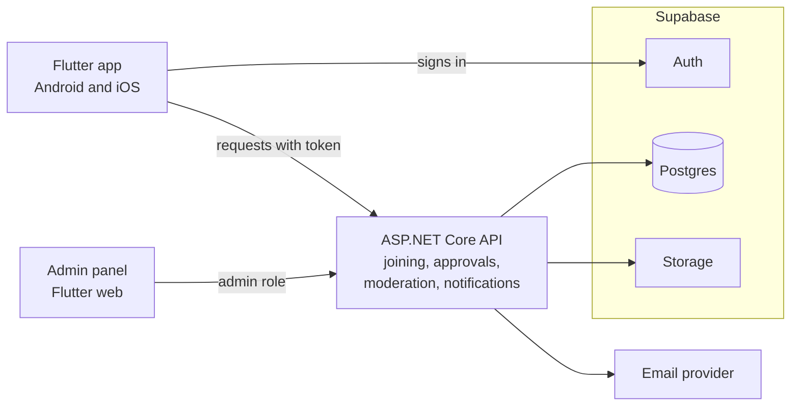
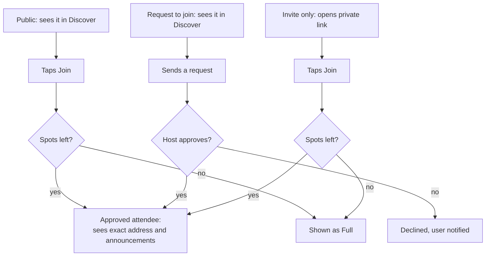

# Gatherly

**Where communities come alive.**

Gatherly is an 18+ app that helps students and young adults find things to do near them, and people to do them with. It brings events, user-hosted gatherings and local discovery together in one place.

> **Status: planning and design.** I'm currently designing the app in Figma and defining the requirements. Code starts once the core screens and design system are done. Follow the [roadmap](#roadmap) to see progress.

---

## The problem

When you move to a new town for university or work, it's hard to know what's happening, where people go, or how to meet people with the same interests. Events are scattered across Instagram, WhatsApp groups and posters, and there's no easy way to start something yourself, like a braai, a hiking group or a gaming night, and invite people beyond your existing friends.

## The solution

One app that answers three questions:

1. **What's happening around me?** Events near you, filtered by date, price, category and *vibe* (Party, Chill, Social, Romantic, Creative, Active, Foodie).
2. **Where can I go and what can I do?** A map of events and gatherings nearby.
3. **Who can I experience it with?** Gatherings hosted by other users, which you can join, request to join or be invited to.

---

## Features

### First release (MVP)

- **Discover:** a feed of events and gatherings in your city, with search, filters and a map
- **Event details:** date, venue, price, age limit, vibes, organiser, directions and ticket links
- **Gatherings:** anyone 18+ can host a gathering, with three access types:
  - **Public:** anyone can join until it's full
  - **Request to join:** the host approves each person
  - **Invite only:** hidden from search and shared by private link
- **Hosting tools:** attendee limit, approve or remove attendees, announcements, edit or cancel
- **Saved and My plans:** bookmarked events, and gatherings you've joined or requested
- **Event submission:** anyone can submit an event; it goes live only after moderation
- **Safety:** 18+ sign-up, report and block, approximate location until approved, and an admin moderation panel

### Later

| Version | Adds |
| --- | --- |
| 1 | Profiles and interests, *Find your crowd*, connections, group chat, push notifications, local places |
| 2 | Organiser and venue profiles, dashboards, identity verification, payments |
| 3 | More countries, languages and currencies; ticketing integrations; recommendations |

---

## Planned tech stack

| Layer | Technology |
| --- | --- |
| Mobile app and admin panel | Flutter and Dart |
| API | ASP.NET Core Web API (C#) |
| Database | PostgreSQL on Supabase, with row-level security |
| Sign-in | Supabase Auth (email and Google) |
| File storage | Supabase Storage |
| Maps | Google Maps Platform |
| Push notifications | Firebase Cloud Messaging (Version 1) |
| Design | Figma |

### Architecture

The app signs in with Supabase Auth. Every other request goes through the ASP.NET Core API, which keeps business rules in one tested place: who can join, when a gathering is full, and who can see a private address. Row-level security in Postgres acts as a second layer of protection.

### How joining a gathering works

---

## Roadmap

- [ ] **1. Design foundations:** colours, type, components, navigation
- [ ] **2. Core screens in Figma:** onboarding, discover, details, create and manage a gathering
- [ ] **3. Backend skeleton:** database, API with sign-in checks, seed data
- [ ] **4. Discover in the app:** sign-up, feed, search, filters, map, details, saves
- [ ] **5. Gatherings:** create, join, approve, announcements, notifications
- [ ] **6. Moderation and safety:** submissions, admin panel, reports, blocks, account deletion
- [ ] **7. Closed beta** with students in one city, then app store release

---

## Safety and privacy by design

- 18+ only, checked at sign-up; identity verification planned for Version 2 through a third-party provider, without storing ID documents
- A gathering's exact address is shown only to approved attendees
- Report and block everywhere, with every admin action logged
- Built to follow South Africa's POPIA: minimal data, account deletion and data download from inside the app

---

## About

Designed and built by **Nhlanhla Mazibuko**, IT student at the Central University of Technology.

[GitHub](https://github.com/NhlanhlayethuMazibuko) · [LinkedIn](https://www.linkedin.com/in/nhlanhlayethu-mazibuko-a5469a242)
